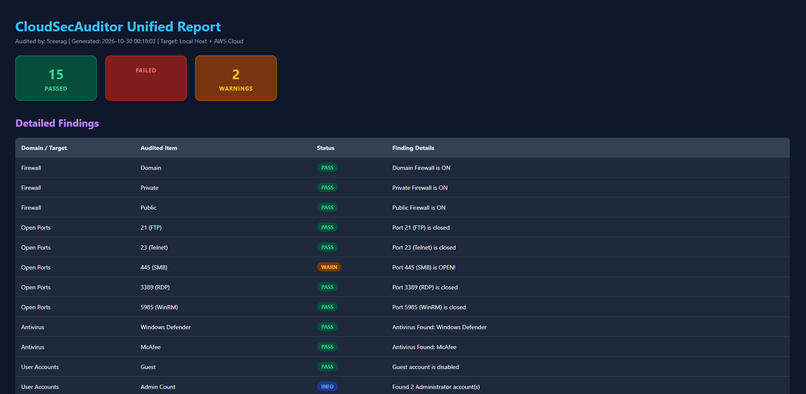
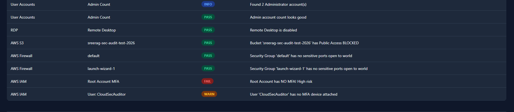
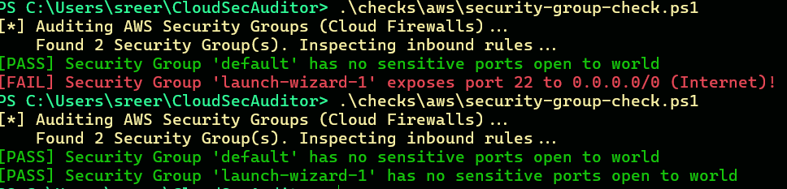
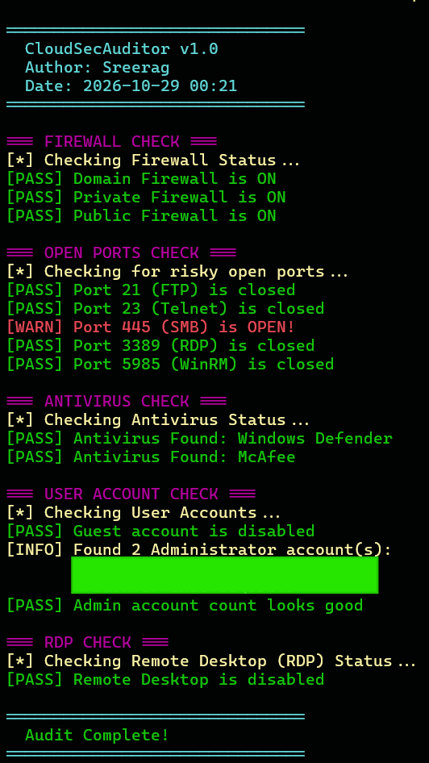

# 🛡️ CloudSecAuditor

> **An automated security inspector that checks both your personal computer and your AWS Cloud for security holes — then builds a visual report of what it finds.**


---

## 👋 What is this project? (The Simple Explanation)

Imagine leaving your house for vacation:
- Did you lock the front door?
- Did you leave a window open?
- Is your security camera turned on?

In the tech world, companies have **hundreds of cloud servers and laptops**, and engineers accidentally leave digital "doors and windows" open all the time. 

I built **CloudSecAuditor** using **PowerShell** to act like a digital home inspector. With a single command, it automatically audits:
1. **Your Local Computer** (firewall, open ports, antivirus, guest accounts)
2. **Your AWS Cloud Environment** (storage buckets, cloud firewalls, master account MFA)

...and then generates an easy-to-read, color-coded **HTML Security Dashboard**.

---

## 📊 What the Report Looks Like

When the audit finishes, it generates this dark-mode dashboard showing what passed and what needs attention:

### Executive Dashboard


### AWS Cloud Findings


---

## 🎯 A Real Problem It Actually Caught & Fixed!

This isn't just theory — while testing this tool on my own live AWS cloud account, **it caught a real security flaw**:

AWS had created a cloud firewall rule that left **Port 22 (SSH - the master login door)** wide open to **anyone on the entire Internet (`0.0.0.0/0`)**!



1. **The Finding:** My tool flagged `launch-wizard-1` with a red `[FAIL]`.
2. **The Fix:** I logged into AWS, restricted the rule so only my private IP could access it, and closed the door to the public internet.
3. **The Proof:** Re-running the tool immediately gave a green `[PASS]`.

---

## 🔍 The 8 Things It Checks

### 💻 On Your Computer:
- **Firewall Check:** Makes sure your computer's built-in shield is ON.
- **Open Ports Check:** Looks for dangerous open doors (like Port 445 used in WannaCry ransomware).
- **Antivirus Check:** Verifies that Defender or another antivirus is actively running.
- **User Accounts:** Ensures the Guest account is turned off and checks how many Admin accounts exist.
- **Remote Desktop (RDP):** Checks if remote access is turned on and requires proper authentication.

### ☁️ In AWS Cloud:
- **S3 Storage Buckets:** Checks if storage buckets are private so files aren't leaked to the public.
- **Cloud Firewalls (Security Groups):** Alerts if servers have management ports open to the whole world.
- **Root Account MFA:** Checks if the master AWS account has Multi-Factor Authentication (phone code) enabled.

---

## 💻 How It Looks in the Terminal



---

## 🛠️ How to Run It Yourself

### 1. Requirements
- Windows 10/11 with PowerShell
- AWS account credentials (optional, if you want cloud checks)

### 2. Download and Run
```powershell
# 1. Clone this repository
git clone https://github.com/SreeragPramod/CloudSecAuditor.git
cd CloudSecAuditor

# 2. (Optional) Set your AWS credentials
Set-AWSCredential -AccessKey "YOUR_ACCESS_KEY" -SecretKey "YOUR_SECRET_KEY" -StoreAs "default"
Set-DefaultAWSRegion -Region "ap-southeast-2"

# 3. Run the auditor!
.\main.ps1
```

Your report will automatically be generated in the `reports\` folder and can be opened in any web browser!

---

## 🧠 Why I Built This

I created this project as part of my journey toward becoming a **Cloud Engineer** and preparing for the **eCPPT** (Certified Professional Penetration Tester) certification. 

Instead of just reading about security rules or memorizing commands, I wanted to **build a tool from scratch** that actively solves a real problem: identifying vulnerabilities before attackers do.

---

## 👤 Author
- **Sreerag** — Aspiring Cloud Security Engineer
- GitHub: [@SreeragPramod](https://github.com/SreeragPramod)